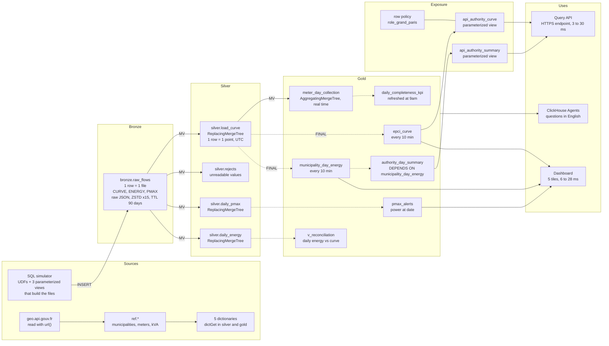

# ClickHouse from zero to advanced · Energy Workshop

One day of smart meter data collection at an electricity distributor, end to end, on **your own ClickHouse Cloud service**:
JSON files in a distribution system operator's format (CURVE 30-min load curves, ENERGY daily energy, PMAX max power)
go to bronze, then silver, then gold, all the way to dashboards, an API and an AI agent.

All data is **simulated in SQL** (no customer files, no external tools) and
deterministic: everyone gets the same numbers.

```
 JSON CURVE/ENERGY/PMAX ──► bronze ──MV──► silver ──MV / refreshable views──► gold ──► dashboard
   (SQL simulator)    1 row          1 row          aggregates, 9am KPI, alerts       API
                      = 1 file       = 1 point                                    AI agent
```

---

## Workshop architecture

Every arrow is a SQL view: nothing runs outside ClickHouse.
Solid arrow: incremental materialized view, triggered on every INSERT. Dotted arrow: refreshable materialized view, recomputed every 10 minutes from the silver tables read with FINAL.



| Layer | Objects | Key takeaway |
|---|---|---|
| **Sources** | SQL simulator (`sim_*` functions, 3 parameterized views), `geo.api.gouv.fr`, `ref.*` reference tables, 5 dictionaries | everything is generated in SQL, deterministically |
| **Bronze** | `bronze.raw_flows` | 1 row = 1 raw JSON file (CURVE, ENERGY, PMAX), compressed ×15, purged after 90 days |
| **Silver** | `load_curve`, `rejects`, `daily_pmax`, `daily_energy` | 4 materialized views unfold the JSON on every INSERT; ReplacingMergeTree keeps the latest version |
| **Gold** | `meter_day_collection`, `daily_completeness_kpi`, `epci_curve`, `municipality_day_energy`, `authority_day_summary`, `pmax_alerts`, `v_reconciliation` | 1 real-time materialized view, 5 refreshable materialized views (10 min or 9am), 1 plain view |
| **Exposure** | `api_authority_curve`, `api_authority_summary`, row policies of the `role_grand_paris` role | the portal only sends parameters; per-territory security lives in the database |
| **Uses** | dashboard, Query API endpoint, ClickHouse Agents | everything reads gold, in a few milliseconds |

Around the main flow: the 1.5 billion point table (module 06), a month replayed and published with REPLACE PARTITION (module 07), observability through the `system.*` tables.

The words and abbreviations of the day are in the [lexicon](#lexicon).

---

## Before the session (20 min, the day before)

1. **Create your ClickHouse Cloud account** on [clickhouse.cloud](https://clickhouse.cloud) with your work email. You get $300 of credits for 30 days, far more than the day needs.
2. **Create a service** with this configuration, the same as the trainer's test service:

   | Setting | Value | Why |
   |---|---|---|
   | Region | AWS **eu-central-1** (Frankfurt) | same as the test service |
   | Replicas | **3** | big scans are spread across the 3 (module 06) |
   | Memory per replica | **64 GB** (16 vCPU), **minimum = maximum** | fixed size: no waiting for autoscaling mid-demo |
   | Idling | **after 1 hour** of inactivity, at least | the service does not go to sleep during a break |

   Indicative cost: 24 compute units (3 × 64 GB / 8 GB), so at most $11 per hour at the highest public rate in the region. A 6-hour day stays under $70. The calculator on [clickhouse.com/pricing](https://clickhouse.com/pricing) gives the exact rate.
3. **Write down the password** of the `default` user shown at creation. It is shown only once. Keep it in a password manager, never in a file of the repo.
4. Open your service's **SQL console** and run `SELECT version();`. If a version shows up, you are ready.
5. Optional, for catching up from the command line: install the native client.
   ```bash
   curl https://clickhouse.com/ | sh
   ```

With this configuration, you will get the durations noted in the comments (`Measured`) of each file, and in [RESULTS.md](RESULTS.md).

---

## Schedule (5 h)

| Time | Module | What we do | Duration |
|---|---|---|---|
| 0:00 | Introduction | The platform: ClickHouse Cloud, separate storage and compute, ClickPipes, Agents | 15 min |
| 0:15 | **00** First steps | From `numbers()` to a daily energy file in JSON, then 1 million measurements in one query | 15 min |
| 0:30 | **01** Fundamentals | MergeTree, sparse index, compression. The 34,969 municipalities read live from geo.api.gouv.fr, 1 million meters | 25 min |
| 0:55 | **02** Bronze | The metering flow simulator (UDFs, parameterized views) and 1,800 raw JSON files, 1.7 GB | 25 min |
| 1:20 | *Break* | | 10 min |
| 1:30 | **03** Silver | Materialized views, triple ARRAY JOIN, backfill, resends, corrections, daylight saving time | 35 min |
| 2:05 | **04** Dictionaries | In-memory reference data, subscribed power "at date" | 15 min |
| 2:20 | **05** Gold | Incremental MV, the sum trap, refreshable materialized views, 9am KPI, PMax alerts, daily energy / curve reconciliation, consumption shapes for data science | 35 min |
| 2:55 | *Break* | | 10 min |
| 3:05 | **06** Performance | 1.5 billion points, primary index, parallel replicas, projection, skip index, cache, advanced SQL | 30 min |
| 3:35 | **07** Operations | Replay and atomic publish, TTL, DELETE, row policies, observability in SQL | 25 min |
| 4:00 | **08** Dashboards, API, Agents | A 5-tile filterable dashboard, a secured Query API endpoint, ClickHouse Agents: 2 questions, 6 dashboards and 3 data science models (forecasting, segmentation, profiling) | 40 min |
| 4:40 | Wrap-up | What we covered, going further, questions | 20 min |

Each module has one or more `.sql` files, to run **in order**. The [module 08 README](08_dashboards_agent/README.md) details the steps in the console (dashboard, API, agent).

---

## In the SQL console

1. Open the module's `.sql` file on GitHub, copy everything, paste it into a new console tab.
2. Shortcuts:

| Shortcut (Mac) | Windows / Linux | Effect |
|---|---|---|
| **Cmd + Enter** | Ctrl + Enter | Runs the **whole** tab |
| **Cmd + Shift + Enter** | Ctrl + Shift + Enter | Runs the **query under the cursor** |

3. To go step by step, put the cursor in a query and use **Cmd + Shift + Enter**. The `What to look for` comments say what to check (duration, rows read, result), the `Measured` comments give the numbers obtained on the test service.
4. Each file ends with a **checkpoint**: a row of `OK`. A `FAIL` means a step was missed. Run the file again, it is idempotent (`CREATE OR REPLACE`, `IF NOT EXISTS`).

Good to know:
- The console gives up on a statement after **~60 s** (the query keeps running on the server). All scripts are split to stay below that.
- A **"Query variables"** panel opens on parameterized views: leave it empty and close it.
- Module 06 inserts 1.5 billion points in 8 batches of about 10 seconds each: one statement per batch to stay under the console limit.

---

## Catching up

Fallen behind, or a module failed? The [`run_all.sh`](run_all.sh) script replays the files with the native client, from your machine, in the `en/` folder:

```bash
cd en
export CH_HOST=<your-service>.<region>.clickhouse.cloud
export CH_PASSWORD='<password>'
```

```bash
./run_all.sh 01 04
```
Replays modules 01 to 04 inclusive, without a reset. Handy to catch up with the group.

```bash
./run_all.sh 05_gold
```
Resumes at a module and runs to the end.

```bash
./run_all.sh
```
Everything from scratch, reset included: about 4 minutes.

The detailed results of each file are in `logs/`. Modules depend on the previous ones: to resume at module 05, modules 00 to 04 must have run.

[`reset.sql`](reset.sql) drops **only** what the workshop created: the `ref`, `bronze`, `silver`, `gold`, `simulator` databases, the `sim_*` functions, the `dict_reader` user, the `role_grand_paris` role and its row policies.

---

## Lexicon

Everything that shows up in the slides and in the repo, in one line.

| Energy business | | ClickHouse | | Platform and data | |
|---|---|---|---|---|---|
| **Meter (PRM)** | delivery point: the 14-digit identifier of a meter | **SQL** | the query language, used for the whole workshop | **JSON** | text format of the files received |
| **CURVE (flow)** | load curve: average power every 30 minutes, in W | **MV** | materialized view: a trigger that transforms every INSERT | **API** | interface a program calls to query a service |
| **ENERGY · PMAX** | daily energy (Wh) and daily maximum power (VA) | **RMV** | refreshable materialized view: scheduled full recompute (10 min, 9am) | **S3 · GCS** | AWS and Google Cloud object storage |
| **CONS · PROD** | energy consumed, and energy produced (solar panels) | **FINAL** | reads the latest version of each row, no duplicates | **CDC (database)** | Change Data Capture: continuous copy of a database's changes |
| **C5 · C4 · C2** | segments: up to 36 kVA, 36 to 250 kVA, connected at medium voltage (HTA) | **TTL** | time to live: automatic purge of rows that are too old | **OTel** | OpenTelemetry: standard for collecting logs, metrics, traces |
| **RES · PRO · ENT** | profiles: residential, professional, enterprise | **UDF** | user-defined SQL function, reusable everywhere | **MCP** | Model Context Protocol: plugs an AI agent into tools and data |
| **EPCI** | intercommunal authority (metropolis, urban area): the perimeter of a local authority | **ASOF JOIN** | join on the closest value, for example at a date | **KPI** | key indicator, for example 99% of data received by 9am |
| **INSEE** | official code of a municipality, 5 characters | **ZSTD** | Zstandard: the algorithm that compresses columns | **BI** | business intelligence: dashboards and reports |
| **VA · W · Wh** | apparent power, active power, energy. k, M, G: thousand, million, billion | **UTC** | universal time, no daylight saving: the storage format | **GDPR** | European regulation on personal data protection |

---

## Repo contents

```
00_introduction/      first steps
01_fundamentals/      basics, MergeTree, reference data (INSEE municipalities, meters)
02_bronze/            metering flow simulator, JSON ingestion
03_silver/            materialized views, duplicates, corrections, daylight saving time
04_dictionaries/      in-memory enrichment
05_gold/              aggregates, refreshable materialized views, 9am KPI, alerts, reconciliation
06_performance/       1.5 billion points, measured optimizations
07_operations/        replay, TTL, security, observability
08_dashboards_agent/  step-by-step README: dashboard, API, ClickHouse Agents (no SQL file)
../data/              backup INSEE reference data (if geo.api.gouv.fr does not answer)
run_all.sh, reset.sql full run and cleanup
RESULTS.md            numbers measured on the test service, module by module
```

## ClickHouse best practices shown

| Rule | Where |
|---|---|
| ORDER BY from lowest to highest cardinality, filters on the key prefix | 01, 03, 06, 08 |
| `LowCardinality` under 10,000 distinct values, no `Nullable` | 01, 03, 05 |
| Bounded partitions (one per month), used for the lifecycle | 02, 03, 07 |
| Large batches on insert | 02, 03, 06 |
| Spread a scan across replicas (storage/compute separation) | 06 |
| Incremental MVs for idempotent aggregates (`uniqExact`, `min`, `max`) | 03, 05 |
| Refreshable materialized views for sums and joins | 05 |
| Dictionaries rather than repeated JOINs | 04, 05, 06, 08 |
| No `OPTIMIZE … FINAL`, no `ALTER UPDATE` in day-to-day use | 03, 07 |
| Documented schema and bounded queries for agents | 08 |
