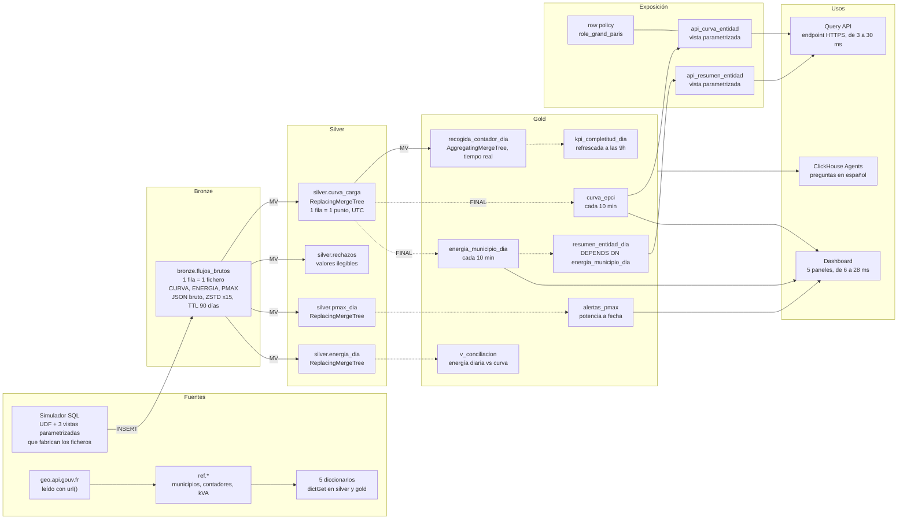

# ClickHouse de cero a avanzado · Workshop Energía

Un día de recogida de los contadores inteligentes de una distribuidora eléctrica, de principio a fin, en **tu propio servicio ClickHouse Cloud**:
ficheros JSON con el formato de una distribuidora (DSO) (CURVA curvas de 30 min, ENERGIA energía diaria, PMAX potencia máxima)
pasan a bronze, luego a silver, luego a gold, hasta llegar a dashboards, a una API y a un agente de IA.

Todos los datos están **simulados en SQL** (ningún fichero de cliente, ninguna herramienta externa) y
son deterministas: todo el mundo obtiene las mismas cifras.

```
 JSON CURVA/ENERGIA/PMAX ──► bronze ──MV──► silver ──MV / vistas refrescables──► gold ──► dashboard
   (simulador SQL)    1 fila         1 fila         agregados, KPI 9h, alertas       API
                      = 1 fichero    = 1 punto                                    agente IA
```

---

## La arquitectura del workshop

Cada flecha es una vista SQL: nada se ejecuta fuera de ClickHouse.
Flecha continua: vista materializada incremental, que se dispara con cada INSERT. Flecha discontinua: vista materializada refrescable, recalculada cada 10 minutos a partir de las tablas silver leídas con FINAL.



| Capa | Objetos | Lo que hay que retener |
|---|---|---|
| **Fuentes** | simulador SQL (funciones `sim_*`, 3 vistas parametrizadas), `geo.api.gouv.fr`, referenciales `ref.*`, 5 diccionarios | todo se genera en SQL, de forma determinista |
| **Bronze** | `bronze.flujos_brutos` | 1 fila = 1 fichero JSON bruto (CURVA, ENERGIA, PMAX), comprimido ×15, purgado a los 90 días |
| **Silver** | `curva_carga`, `rechazos`, `pmax_dia`, `energia_dia` | 4 vistas materializadas despliegan el JSON en cada INSERT; ReplacingMergeTree conserva la última versión |
| **Gold** | `recogida_contador_dia`, `kpi_completitud_dia`, `curva_epci`, `energia_municipio_dia`, `resumen_entidad_dia`, `alertas_pmax`, `v_conciliacion` | 1 vista materializada en tiempo real, 5 vistas materializadas refrescables (10 min o 9h), 1 vista simple |
| **Exposición** | `api_curva_entidad`, `api_resumen_entidad`, row policies del rol `role_grand_paris` | el portal solo envía parámetros; la seguridad por territorio está en la base de datos |
| **Usos** | dashboard, Query API endpoint, ClickHouse Agents | todo lee gold, en pocos milisegundos |

Alrededor del flujo principal: la tabla de 1 500 millones de puntos (módulo 06), el reproceso de un mes publicado con REPLACE PARTITION (módulo 07) y la observabilidad con las tablas `system.*`.

Las palabras y abreviaturas del día están en el [glosario](#glosario).

---

## Antes de la sesión (20 min, el día anterior)

1. **Crea tu cuenta de ClickHouse Cloud** en [clickhouse.cloud](https://clickhouse.cloud) con tu dirección profesional. Se ofrecen 300 $ de créditos durante 30 días, más que suficiente para el día.
2. **Crea un servicio** con esta configuración, la misma que el servicio de pruebas del formador:

   | Ajuste | Valor | Por qué |
   |---|---|---|
   | Región | AWS **eu-central-1** (Fráncfort) | la misma que el servicio de pruebas |
   | Réplicas | **3** | los escaneos grandes se reparten entre las 3 (módulo 06) |
   | Memoria por réplica | **64 GB** (16 vCPU), **mínimo = máximo** | tamaño fijo: sin esperas de autoscaling en plena demo |
   | Suspensión | **tras 1 hora** de inactividad, como mínimo | el servicio no se duerme durante una pausa |

   Coste orientativo: 24 unidades de cómputo (3 × 64 GB / 8 GB), es decir, como mucho 11 $ por hora a la tarifa pública más alta de la región. Un día de 6 horas se queda por debajo de 70 $. La calculadora de [clickhouse.com/pricing](https://clickhouse.com/pricing) da la tarifa exacta.
3. **Apunta la contraseña** del usuario `default` que aparece al crear el servicio. Solo se muestra una vez. Guárdala en un gestor de contraseñas, nunca en un fichero del repo.
4. Abre la **consola SQL** del servicio y lanza `SELECT version();`. Si aparece una versión, estás listo.
5. Opcional, para ponerte al día desde la línea de comandos: instala el cliente nativo.
   ```bash
   curl https://clickhouse.com/ | sh
   ```

Con esta configuración, encontrarás las duraciones anotadas en comentario (`Medido`) en cada fichero, y también en [`RESULTADOS.md`](RESULTADOS.md).

---

## Desarrollo (5 h)

| Horario | Módulo | Qué hacemos | Duración |
|---|---|---|---|
| 0:00 | Introducción | La plataforma: ClickHouse Cloud, almacenamiento y cómputo separados, ClickPipes, Agents | 15 min |
| 0:15 | **00** [Primeros pasos](00_introduccion/01_primeros_pasos.sql) | De `numbers()` a un fichero de energía diaria en JSON, y luego 1 millón de medidas en una consulta | 15 min |
| 0:30 | **01** [Fundamentos](01_fundamentos/01_configuracion_y_referenciales.sql) | MergeTree, índice disperso, compresión. Los 34 969 municipios leídos en directo de geo.api.gouv.fr, 1 millón de contadores | 25 min |
| 0:55 | **02** [Bronze](02_bronze/) | El simulador de flujos de medida (UDF, vistas parametrizadas) y 1 800 ficheros JSON brutos, 1,7 GB | 25 min |
| 1:20 | *Pausa* | | 10 min |
| 1:30 | **03** [Silver](03_silver/) | Vistas materializadas, triple ARRAY JOIN, backfill, reenvíos, correcciones, cambio de hora | 35 min |
| 2:05 | **04** [Diccionarios](04_diccionarios/01_diccionarios.sql) | Referenciales en memoria, potencia contratada "a fecha" | 15 min |
| 2:20 | **05** [Gold](05_gold/) | MV incremental, trampa de la suma, vistas materializadas refrescables, KPI 9h, alertas PMax, conciliación energía diaria / curva, formas de consumo para data science | 35 min |
| 2:55 | *Pausa* | | 10 min |
| 3:05 | **06** [Rendimiento](06_rendimiento/) | 1 500 millones de puntos, índice primario, réplicas en paralelo, proyección, índice de salto, caché, SQL avanzado | 30 min |
| 3:35 | **07** [Operación](07_operacion/) | Reproceso y publicación atómica, TTL, DELETE, row policies, observabilidad en SQL | 25 min |
| 4:00 | **08** [Dashboards, API, Agents](08_dashboards_agente/README.md) | Dashboard de 5 paneles filtrables, un Query API endpoint seguro, ClickHouse Agents: 2 preguntas, 6 dashboards y 3 modelos de data science (previsión, segmentación, perfilado) | 40 min |
| 4:40 | Conclusión | Lo que hemos visto, para ir más lejos, preguntas | 20 min |

Cada módulo tiene uno o varios ficheros `.sql`, que se ejecutan **en orden**. El [README del módulo 08](08_dashboards_agente/README.md) detalla los pasos en la consola (dashboard, API, agente).

---

## En la consola SQL

1. Abre el fichero `.sql` del módulo en GitHub, cópialo entero y pégalo en una pestaña nueva de la consola.
2. Atajos:

| Atajo (Mac) | Windows / Linux | Efecto |
|---|---|---|
| **Cmd + Intro** | Ctrl + Intro | Ejecuta **toda** la pestaña |
| **Cmd + Mayús + Intro** | Ctrl + Mayús + Intro | Ejecuta la **consulta bajo el cursor** |

3. Para avanzar paso a paso, coloca el cursor en una consulta y usa **Cmd + Mayús + Intro**. Los comentarios `Qué observar` dicen qué mirar (duración, filas leídas, resultado), los comentarios `Medido` dan las cifras obtenidas en el servicio de pruebas.
4. Cada fichero termina con un **checkpoint**: una fila de `OK`. Un `ERROR` significa que ha fallado un paso. Vuelve a lanzar el fichero, es idempotente (`CREATE OR REPLACE`, `IF NOT EXISTS`).

Conviene saber:
- La consola abandona una instrucción pasados **~60 s** (la consulta sigue en el servidor). Todos los scripts están troceados para quedarse por debajo.
- Al usar vistas parametrizadas se abre un panel **"Query variables"**: déjalo vacío y ciérralo.
- El módulo 06 inserta 1 500 millones de puntos en 8 lotes de unos 10 segundos: una instrucción por lote para no superar el límite de la consola.

---

## Ponerse al día

¿Te has quedado atrás o ha fallado un módulo? El script [`run_all.sh`](run_all.sh) vuelve a ejecutar los ficheros con el cliente nativo, desde tu equipo, en la carpeta `es/`:

```bash
cd es
export CH_HOST=<tu-servicio>.<región>.clickhouse.cloud
export CH_PASSWORD='<contraseña>'
```

```bash
./run_all.sh 01 04
```
Vuelve a ejecutar del módulo 01 al 04 incluido, sin reset. Útil para alcanzar al grupo.

```bash
./run_all.sh 05_gold
```
Retoma desde un módulo y llega hasta el final.

```bash
./run_all.sh
```
Todo desde cero, reset incluido: unos 4 minutos.

Los resultados detallados de cada fichero quedan en `logs/`. Los módulos dependen de los anteriores: para retomar en el módulo 05, los módulos 00 a 04 tienen que haberse ejecutado.

[`reset.sql`](reset.sql) borra **únicamente** lo que ha creado el workshop: las bases de datos `ref`, `bronze`, `silver`, `gold`, `simulador`, las funciones `sim_*`, el usuario `dict_reader`, el rol `role_grand_paris` y sus row policies.

---

## Glosario

Todo lo que aparece en las slides y en el repo, en una línea.

| Negocio de la energía | | ClickHouse | | Plataforma y datos | |
|---|---|---|---|---|---|
| **Contador (PRM)** | punto de medida, identificado por 14 dígitos (`id_contador`) | **SQL** | el lenguaje de las consultas, usado en todo el workshop | **JSON** | formato de texto de los ficheros recibidos |
| **CURVA (flujo)** | curva de carga: potencia media cada 30 minutos, en W | **MV** | vista materializada: trigger que transforma cada INSERT | **API** | interfaz a la que llama un programa para consultar un servicio |
| **ENERGIA · PMAX** | energía del día (Wh) y potencia máxima del día (VA) | **RMV** | vista materializada refrescable: recálculo completo programado (10 min, 9h) | **S3 · GCS** | almacenamiento de objetos de AWS y de Google Cloud |
| **CONS · PROD** | energía consumida y energía producida (paneles solares) | **FINAL** | lee la última versión de cada fila, sin duplicados | **CDC (base de datos)** | Change Data Capture: copia continua de los cambios de una base de datos |
| **C5 · C4 · C2** | segmentos: hasta 36 kVA, de 36 a 250 kVA, conectado en media tensión (HTA) | **TTL** | tiempo de vida: purga automática de las filas demasiado antiguas | **OTel** | OpenTelemetry: estándar de recogida de logs, métricas y trazas |
| **RES · PRO · ENT** | perfiles: residencial, profesional, empresa | **UDF** | función SQL definida por el usuario, reutilizable en cualquier sitio | **MCP** | Model Context Protocol: conecta un agente de IA con herramientas y datos |
| **EPCI** | mancomunidad (metrópoli, área urbana): ámbito de una entidad local | **ASOF JOIN** | unión con el valor más cercano, por ejemplo a una fecha | **KPI** | indicador clave, por ejemplo el 99 % de los datos recibidos a las 9h |
| **INSEE** | código oficial de un municipio, 5 caracteres | **ZSTD** | Zstandard: el algoritmo que comprime las columnas | **BI** | inteligencia de negocio: cuadros de mando e informes |
| **VA · W · Wh** | potencia aparente, potencia activa, energía. k, M, G: mil, millón, mil millones | **UTC** | tiempo universal, sin cambio de hora: el formato de almacenamiento | **RGPD** | reglamento europeo de protección de datos personales |

---

## Contenido del repo

| Carpeta o fichero | Contenido |
|---|---|
| [`00_introduccion/`](00_introduccion/) | primeros pasos |
| [`01_fundamentos/`](01_fundamentos/) | bases de datos, MergeTree, referenciales (municipios INSEE, contadores) |
| [`02_bronze/`](02_bronze/) | simulador de flujos de medida, ingesta de los JSON |
| [`03_silver/`](03_silver/) | vistas materializadas, duplicados, correcciones, cambio de hora |
| [`04_diccionarios/`](04_diccionarios/) | enriquecimiento en memoria |
| [`05_gold/`](05_gold/) | agregados, vistas materializadas refrescables, KPI 9h, alertas, conciliación |
| [`06_rendimiento/`](06_rendimiento/) | 1 500 millones de puntos, optimizaciones medidas |
| [`07_operacion/`](07_operacion/) | reproceso, TTL, seguridad, observabilidad |
| [`08_dashboards_agente/`](08_dashboards_agente/README.md) | README paso a paso: dashboard, API, ClickHouse Agents (ningún fichero SQL) |
| [`../data/`](../data/) | referenciales INSEE de respaldo (si geo.api.gouv.fr no responde), en la raíz del repo |
| [`run_all.sh`](run_all.sh), [`reset.sql`](reset.sql) | ejecución completa y limpieza |
| [`RESULTADOS.md`](RESULTADOS.md) | cifras medidas en el servicio de pruebas, módulo a módulo |

## Buenas prácticas de ClickHouse ilustradas

| Regla | Dónde |
|---|---|
| ORDER BY de menor a mayor cardinalidad, filtros sobre el prefijo de la clave | 01, 03, 06, 08 |
| `LowCardinality` por debajo de 10 000 valores distintos, sin `Nullable` | 01, 03, 05 |
| Particiones acotadas (una por mes), usadas para el ciclo de vida | 02, 03, 07 |
| Lotes grandes al insertar | 02, 03, 06 |
| Repartir un escaneo entre las réplicas (separación almacenamiento/cómputo) | 06 |
| MV incrementales para los agregados idempotentes (`uniqExact`, `min`, `max`) | 03, 05 |
| Vistas materializadas refrescables para las sumas y las uniones | 05 |
| Diccionarios en lugar de JOIN repetidos | 04, 05, 06, 08 |
| Nada de `OPTIMIZE … FINAL` ni de `ALTER UPDATE` en el uso diario | 03, 07 |
| Esquema documentado y consultas acotadas para los agentes | 08 |
